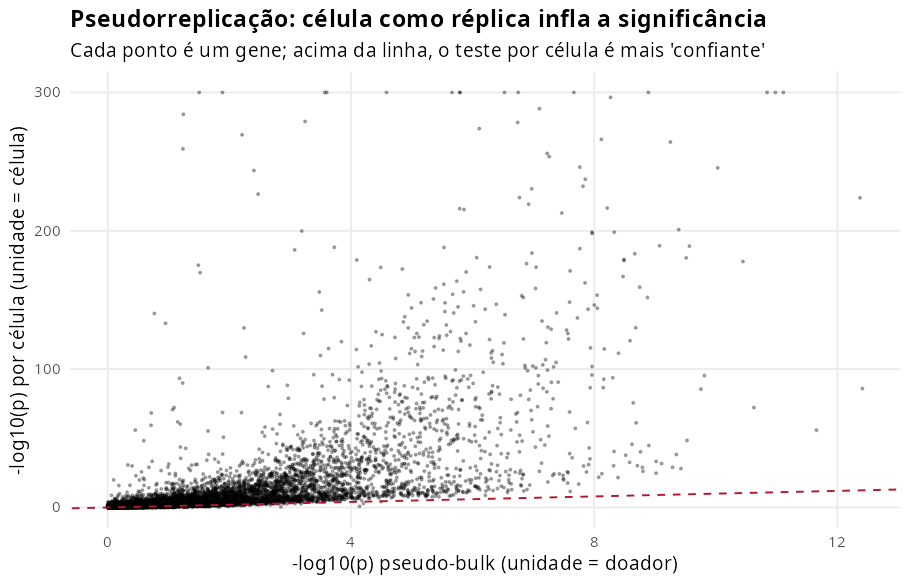
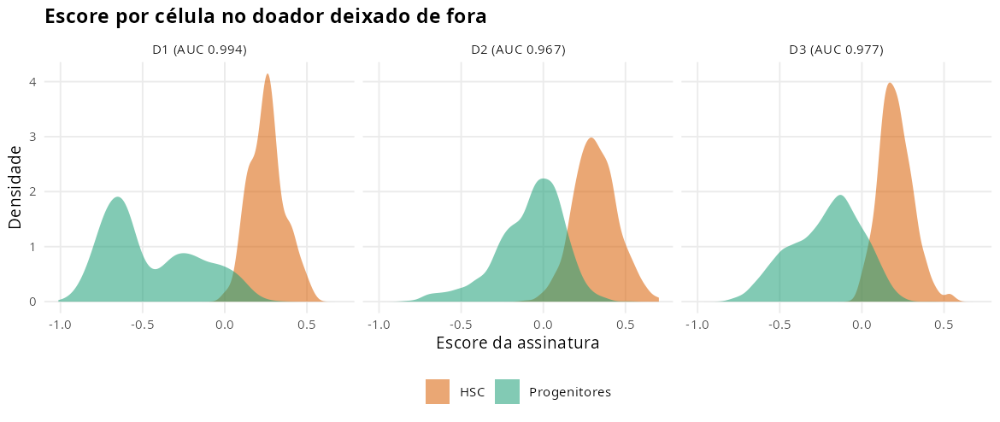
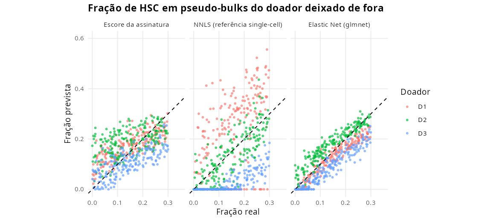
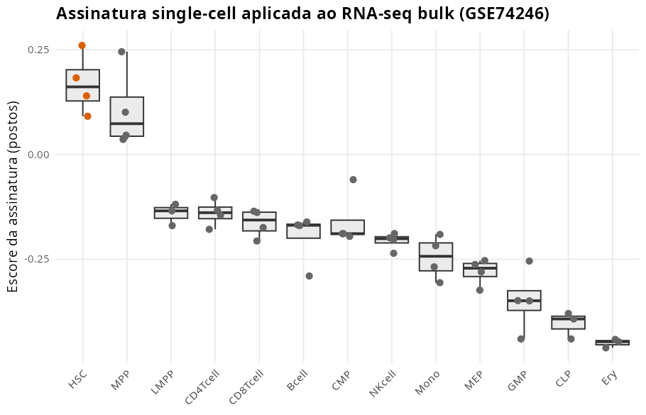

# Assinatura de HSC em célula única e estimativa de abundância em pseudo-bulk, em R

Projeto didático de **scRNA-seq e estatística** com o GSE139369 (Granja et al., 2019): 35.582 células de medula óssea, células CD34+ e sangue periférico humanos, anotadas pelos autores em 26 grupos. O foco é o compartimento CD34+ (8.795 células, 1.421 delas HSC) dos três doadores que têm HSC.

**Em uma frase:** a assinatura aprendida em pseudo-bulk separa HSC de progenitores em doadores novos com AUC de 0,97 a 0,99. Um Elastic Net treinado com misturas de células reais estima a fração de HSC num doador que nunca viu com RMSE de 0,047. A mesma assinatura reconhece HSC num RNA-seq bulk de outro laboratório (AUC de 0,98).

Faz parte de um portfólio de três estudos sobre o mesmo tema: estimar o enriquecimento de HSC em preparações celulares para terapia gênica e regenerativa. Os outros dois usam microarray ([GSE24759](../RESOLUCAO_GITHUB_GSE24759_Novershtern2011_DMAP)) e RNA-seq bulk ([GSE74246](../RESOLUCAO_GITHUB_GSE74246_Corces2016)).

Notebook no Kaggle (em inglês): **[inserir link após publicar]**

## O que este projeto ensina

1. Trabalhar com um `SummarizedExperiment` esparso de 10x sem converter tudo para matriz densa.
2. Fazer **expressão diferencial em pseudo-bulk**, pareada por doador, com limma-voom.
3. Medir a **pseudorreplicação**: quanto o teste célula a célula infla a significância.
4. Validar uma assinatura **deixando um doador de fora**, com IC de DeLong e uma nula de 1.000 conjuntos aleatórios de genes.
5. Montar **misturas pseudo-bulk com células reais** e fração de HSC conhecida.
6. Fazer deconvolução por NNLS com **perfis por célula** (contagens médias, não CPM), para estimar frações de células e não de RNA.
7. Levar uma assinatura de **célula única para RNA-seq bulk** com um escore por postos.

## Como executar

Requisitos: R ≥ 4.3 e cerca de 4 GB de memória. O objeto dos autores (≈ 270 MB) é baixado na primeira execução.

```bash
Rscript scripts/install_packages.R   # SummarizedExperiment e limma (Bioconductor), glmnet, nnls...
Rscript main.R                       # cerca de 5 minutos; grava tudo em reports/
Rscript tests/testthat.R             # 15 testes com dados de brinquedo
```

As versões exatas dos pacotes usadas para gerar `reports/` estão em `scripts/package_versions.txt` e em `reports/session_info.txt`. Os testes rodam sozinhos no GitHub Actions a cada envio (`.github/workflows/tests.yml`).

O notebook `notebooks/assinatura-hsc-celula-unica.ipynb` percorre o estudo passo a passo.

## Estrutura

```
├── main.R                    # executa o estudo completo
├── R/
│   ├── config.R              # grupos celulares, doadores, limiares, tamanhos das misturas
│   ├── data.R                # leitura do objeto, compartimento CD34+, pseudo-bulk, normalização
│   ├── differential.R        # limma-voom pareado, teste por célula, assinaturas
│   ├── simulation.R          # misturas com células reais
│   ├── models.R              # escore, NNLS com referência single-cell, Elastic Net
│   ├── validation.R          # doador deixado de fora em célula e em pseudo-bulk
│   ├── evaluation.R          # métricas, bootstrap, Wilcoxon + Holm, AUC
│   ├── transfer.R            # assinatura aplicada ao RNA-seq bulk do GSE74246
│   └── plots.R
├── tests/                    # testthat
├── notebooks/                # notebook em português
├── scripts/
└── reports/                  # metrics.json, tabelas, figuras e sessionInfo
```

## Dados

| Doador | Tecido | HSC | Progenitores CD34+ |
|---|---|---|---|
| D1 | Medula óssea total (2 corridas técnicas) | 206 | 1.640 |
| D2 | Células CD34+ purificadas | 612 | 1.511 |
| D3 | Células CD34+ purificadas | 603 | 4.223 |

Progenitores: grupos `02_Early.Eryth`, `04_Early.Baso`, `05_CMP.LMPP`, `06_CLP.1`, `07_GMP` e `15_CLP.2` da anotação dos autores. O doador D4 (sangue periférico) tem só 4 células HSC e fica de fora.

## Resultados

Todos os números vêm de `reports/metrics.json`, gerado por `main.R`.

### 1. Pseudo-bulk e pseudorreplicação

Com o modelo `~ doador + tipo`, que compara HSC e progenitores **dentro** de cada doador, 516 genes ficam mais altos e 588 mais baixos em HSC (FDR < 5%, diferença maior que 2 vezes). Entre os 50 mais altos estão 7 marcadores clássicos: HLF, CRHBP, AVP, MECOM, HOPX, MLLT3 e EMCN (hipergeométrico, p = 3 × 10⁻¹³). Os mais baixos são de proliferação (TYMS, PCNA, NUSAP1) e de comprometimento linfoide B (IGLL1, VPREB1), coerente com HSC quiescentes.

| Teste | Unidade de réplica | Genes com FDR < 5% | Mediana de −log10(p) |
|---|---|---|---|
| Pseudo-bulk (limma-voom pareado) | Doador (n = 3) | 2.947 | 0,99 |
| t de Welch por célula | Célula (n = 8.795) | 5.650 | 2,52 |

O teste por célula declara quase o dobro de genes significativos. A biologia é a mesma; a diferença vem de tratar células correlacionadas como réplicas independentes (Squair et al., 2021).



### 2. A assinatura num doador novo (nível de célula)

| Doador de teste | HSC / progenitores | AUC da assinatura (IC 95%) | AUC dos marcadores clássicos | Percentil 95 dos aleatórios |
|---|---|---|---|---|
| D1 | 206 / 1.640 | 0,994 (0,991–0,996) | 0,982 | 0,69 |
| D2 | 612 / 1.511 | 0,967 (0,960–0,974) | 0,940 | 0,60 |
| D3 | 603 / 4.223 | 0,977 (0,973–0,981) | 0,941 | 0,61 |

Em cada rodada, a assinatura usa só os dois doadores de treino e exige que o gene mude na mesma direção nos dois. Ela supera os marcadores clássicos nos três doadores e todos os 1.000 conjuntos aleatórios (p = 0,001).



### 3. Fração de HSC em pseudo-bulks de células reais

Cada mistura soma 500 células reais de um doador, com fração de HSC entre 0 e 30%. O treino usa 600 misturas de dois doadores e o teste, 200 do terceiro.

| Modelo | RMSE | IC 95% | CCC | Índice C | RMSE D1 / D2 / D3 |
|---|---|---|---|---|---|
| Referência (média) | 0,085 | 0,082–0,088 | 0,01 | 0,52 | 0,086 / 0,084 / 0,084 |
| **Elastic Net (glmnet)** | **0,047** | 0,044–0,049 | **0,84** | **0,83** | 0,036 / 0,042 / 0,058 |
| Escore da assinatura | 0,071 | 0,067–0,075 | 0,57 | 0,71 | 0,058 / 0,084 / 0,067 |
| NNLS (referência single-cell) | 0,121 | 0,115–0,126 | 0,45 | 0,68 | 0,155 / 0,062 / 0,126 |

O Elastic Net vence os outros métodos nos três doadores (Wilcoxon pareado, Holm p < 10⁻²¹). O NNLS é o mais fraco e o mais instável: diferenças de profundidade e de doador entre referência e amostra o prejudicam.



### 4. De célula única para RNA-seq bulk

A assinatura de pseudo-bulk (50 + 50 genes, todos presentes no RNA-seq) aplicada ao GSE74246, de outro laboratório:

* **AUC de 0,98** para HSC contra as outras 12 populações (p aleatório = 0,004). As HSC ficam nas posições 1, 3, 4 e 6 entre 49 amostras.
* **HSC contra MPP:** p = 0,17. Como a assinatura do DMAP, ela marca o compartimento multipotente.



## Limitações

* Três doadores, de tecidos diferentes (medula total e CD34+ purificado).
* Os rótulos de HSC são os grupos dos autores, não ensaios funcionais de enxertia.
* As misturas têm só células do compartimento CD34+, sem contaminação madura (tratada no estudo de RNA-seq bulk).
* Com dois doadores de treino, o λ do glmnet é escolhido por partições aleatórias do treino; a avaliação, porém, é sempre no doador de fora.
* Nenhuma assinatura deste portfólio separa HSC de MPP em RNA-seq bulk.

## Referências

* Granja J. M. et al. (2019). Single-cell multiomic analysis identifies regulatory programs in mixed-phenotype acute leukemia. *Nature Biotechnology* 37:1458–1465.
* Squair J. W. et al. (2021). Confronting false discoveries in single-cell differential expression. *Nature Communications* 12:5692.
* Law C. W. et al. (2014). voom: precision weights unlock linear model analysis tools for RNA-seq read counts. *Genome Biology* 15:R29.
* Corces M. R. et al. (2016). *Nature Genetics* 48:1193–1203.
* Venet D. et al. (2011). *PLoS Computational Biology* 7:e1002240.

## Licença

Código sob a licença MIT (ver `LICENSE`). Os dados pertencem aos autores e ao GEO/NCBI; cite os artigos originais ao reutilizá-los.

Autor: Duíllio Campos Bovi · [github.com/duilliobovi](https://github.com/duilliobovi)
